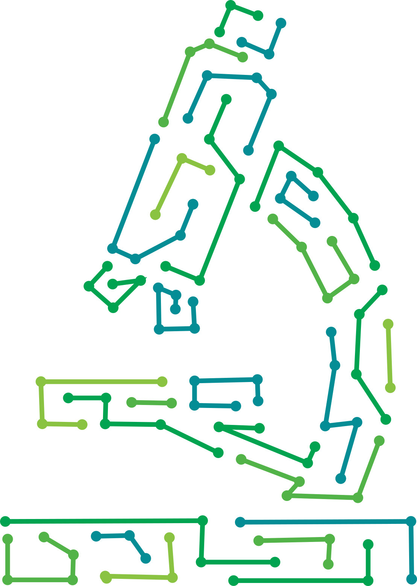

# AI in Microscopy: A BioImaging Guide

This repository contains the source code for 
[AI in Microscopy: A BioImaging Guide](https://bioimagingai.janelia.org/), an 
interactive online textbook intended to introduce biologists and microscopists 
to the fundamentals of artificial intelligence and machine learning.

Please see [CONTRIBUTING](CONTRIBUTING.md) for authoring instructions. Direct 
any questions to the editors ([@ScientistRachel](https://github.com/ScientistRachel) and [@opp1231](https://github.com/opp1231)).

